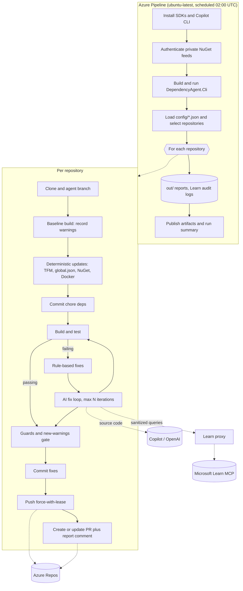

# dependency-agent

An overnight Azure Pipeline that upgrades a configurable list of Azure Repos repositories to the latest .NET LTS (currently `net10.0`) and opens **one pull request per repository** for a human to review. It is a .NET 10 CLI plus pipeline definition that lives in its own central repository.

For each target repository it:

1. clones the repository and creates or resets the branch `dependency-agent/net10-lts`;
2. retargets SDK-style projects to the configured target framework, updates `global.json`, NuGet packages (latest stable; `Microsoft.*`/`System.*` families aligned to the target major) and `mcr.microsoft.com/dotnet/*` images in Dockerfiles;
3. restores, builds and tests, then fixes deprecated or changed APIs with declarative rewrite rules and, where allowed, an AI provider (GitHub Copilot CLI or an OpenAI API key);
4. enforces guards (maximum changed files and lines, allowed edit patterns, protected paths) and a "no new warnings" gate;
5. pushes the branch and creates or updates the pull request, with a full report as a comment.

.NET Framework projects are reported, never migrated.

## Guarantees

- **A human always reviews.** The agent never completes, approves or auto-merges a PR. Protect the target branches with a reviewer policy and build validation (see [docs/security.md](docs/security.md)).
- **Draft on failure.** If the build, tests, guards or the new-warnings gate are not green, the PR is created as a **draft** with the failure reasons. Only a fully green run produces a ready-for-review PR.
- **Bounded changes.** Code fixes are limited to allowed file patterns, never touch protected paths (authentication, authorization, cryptography, security folders, keys, `appsettings*.json`, pipelines), and are reverted if they exceed the change budget or weaken or delete tests.
- **Constrained data flow.** Repository source code is sent only to the configured AI provider and only for repositories where AI is enabled. Microsoft Learn documentation lookups go through a local sanitizing proxy that lets only public API names and diagnostic codes out; every outbound query is audit-logged. See the data-flow table in [docs/security.md](docs/security.md).
- **No secret sprawl.** Each child process gets only the credentials its job needs; build and test processes get none.
- **Idempotent and non-destructive.** Re-runs update the same branch and PR. If someone pushed their own commits to the agent branch, the repository is skipped.

## Architecture



## Quick start

1. Import this repository into Azure Repos and create a pipeline from `azure-pipelines.yml` ([docs/setup.md](docs/setup.md)).
2. Create the variable group `dependency-agent-secrets` with `COPILOT_GITHUB_TOKEN` and/or `OPENAI_API_KEY` (secret) and link it to the pipeline.
3. Grant the pipeline's build identity Read, Contribute, Create branch and Contribute to pull requests on every target repository.
4. List your repositories in `config/repositories.json` (start with `"enabled": true, "ring": "pilot"` on one or two).
5. Run the pipeline manually with `dryRun: true` and `repositories: ring:pilot`, inspect the `out/` artifact, then switch `dryRun` off.

Local run (needs the .NET 10 SDK; Git; credentials as environment variables):

```bash
dotnet build DependencyAgent.slnx
dotnet test DependencyAgent.slnx
```

The CLI reads `config/` and writes reports to `out/`; see [docs/how-it-works.md](docs/how-it-works.md) for what a run produces.

## Repository layout

```
azure-pipelines.yml            Scheduled pipeline definition
config/
  defaults.json                Central defaults (all settings)
  repositories.json            Inventory of target repositories and per-repository overrides
  rewrite-rules.json           Declarative regex rewrite rules
schemas/                       JSON Schemas for the files above and for a repo's .dependency-agent.json
src/
  DependencyAgent.Core         Settings, config merge rules, glob matching, process runner, build-target detection
  DependencyAgent.Updates      TFM, global.json, NuGet and Docker updaters
  DependencyAgent.Verification Restore/build/test, diagnostics parsing, change guards
  DependencyAgent.Fixing       Rule-based fixer, AI providers, fix loop
  DependencyAgent.LearnProxy   Sanitizing, audit-logging proxy to the Microsoft Learn MCP server
  DependencyAgent.AzureDevOps  Git workspace and pull request client
  DependencyAgent.Cli          Orchestrator and entry point
tests/                         Unit tests per module
tests/fixtures/SampleLegacyApp A net8.0 repository used by the end-to-end test
docs/                          Documentation
```

## Documentation

- [docs/setup.md](docs/setup.md): importing the repo, pipeline, secrets, permissions, project settings, schedule, first dry run
- [docs/configuration.md](docs/configuration.md): every setting, the inventory, per-repository overrides, package policy, rewrite rules, filters
- [docs/security.md](docs/security.md): data flow, secret scoping, guards, residual risks
- [docs/how-it-works.md](docs/how-it-works.md): the per-repository flow, outcomes and reports
- [docs/troubleshooting.md](docs/troubleshooting.md): common failures and fixes
- [CHANGELOG.md](CHANGELOG.md)
