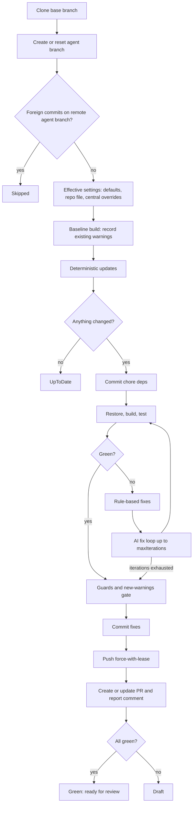

# How it works

## Pipeline stages

1. **Prepare.** The scheduled pipeline installs the required .NET SDKs (the agent's own SDK, and the SDK(s) target repositories pin in `global.json` where needed) and, if the Copilot provider is used, the Copilot CLI. `NuGetAuthenticate` makes private feed credentials available to restore.
2. **Run.** `DependencyAgent.Cli` loads `config/defaults.json`, `config/repositories.json` and `config/rewrite-rules.json`, applies the `repositories` filter and processes the selected repositories one at a time. A failure in one repository never stops the others.
3. **Publish.** Per-repository reports, a run summary table and the Learn audit logs are published as pipeline artifacts; the summary also appears on the run page.

## Per-repository flow

### Steps in detail

1. **Clone.** Shallow-enough clone of `baseBranch` into a temporary directory. The job token is passed per command and never stored. Hooks are disabled.
2. **Agent branch.** The local branch `dependency-agent/net10-lts` is created or reset from the base branch, and the commit identity configured. If the remote agent branch already holds commits by anyone other than the agent identity, the repository is `Skipped`: a human has taken over the branch.
3. **Settings.** Effective settings are built from defaults, the repository's own `.dependency-agent.json` and the central `overrides` (see [configuration.md](configuration.md)).
4. **Baseline build.** The untouched repository is restored and built to record the warnings that already exist. Later, only warnings that are *new* count against the repository. A baseline that does not build is noted; the run continues but cannot be attributed to the upgrade.
5. **Deterministic updates** (idempotent, no AI involved):
   - **Target framework.** SDK-style projects on older modern TFMs (and multi-targeting lists) are retargeted to `targetFramework`. .NET Framework and other non-SDK projects are listed in the report and left untouched.
   - **`global.json`.** The SDK version is moved to the target SDK; `rollForward` is preserved.
   - **NuGet.** Latest stable versions (prerelease only if allowed), `trackTargetMajorFor` families aligned to the target major, `pins`, `maxMajor` and `ignore` honoured. Central package management (`Directory.Packages.props`), `PackageReference` versions and `packages.lock.json` repos are handled.
   - **Docker.** `mcr.microsoft.com/dotnet/*` image tags in Dockerfiles are moved to the target version, keeping the OS variant (for example `-bookworm-slim`).
6. **Commit.** `chore(deps): upgrade to net10.0 and update packages` (message summarises the changes). If nothing changed the outcome is `UpToDate` and nothing is pushed.
7. **Build and test.** `dotnet restore` (feed credentials only), `dotnet build --no-restore` and `dotnet test --no-build` (no secrets), using `verification.*` settings.
8. **Rule-based fixes.** If the build fails, rewrite rules whose `diagnostics` appear in the output are applied to the files those diagnostics point at, plus optional `dotnet format analyzers` for `ruleFixes.formatDiagnostics`. The build is re-run.
9. **AI loop.** If still failing (or there are new warnings) and AI is enabled and available, the provider receives the failing diagnostics, prior changes and the allowed/protected patterns, edits files in the working tree, and the agent re-builds. At most `ai.maxIterations` iterations. Documentation lookups go through the sanitizing Learn proxy. If the provider is not available (token missing, CLI absent) this is recorded and the loop is skipped.
10. **Guards.** The change guard compares the working tree to the commit that holds the deterministic updates: files outside the allowed patterns or inside protected paths are reverted; the change budget (`maxChangedFiles`, `maxChangedLines`, excluding `budgetExcludePatterns`) is checked; test-tampering is detected. Violations are recorded as failure reasons.
11. **New-warnings gate.** If `failOnNewWarnings`, any warning in the upgraded build that is not in the baseline (compared by code, file and message, ignoring line numbers) makes the run not green.
12. **Commit fixes.** `fix: adapt code to net10.0 API changes` for rule and AI changes.
13. **Push.** `git push --force-with-lease` of the agent branch. Skipped in dry run.
14. **PR.** The PR from the agent branch to the base branch is created, or the active one is updated (title, description, draft state). The description holds a summary; a comment holds the full report (changes, diagnostics, test failures, AI summaries, guard results). Labels, reviewers and work items from `pullRequest` are applied. The PR is **never** completed or auto-merged.

## Outcomes

| Outcome | Meaning | PR |
|---|---|---|
| `UpToDate` | Nothing to update. | none |
| `Green` | Changes made; build, tests, guards and new-warnings gate pass. | Ready for review |
| `Draft` | Changes made but something failed (build, tests, guard, new warnings, baseline red, AI unavailable and needed). Reasons are in the report. | Draft |
| `Skipped` | Not processed: foreign commits on the agent branch, unsupported layout (for example only .NET Framework projects). | none |
| `Failed` | Agent error (clone, permission, unexpected exception). | none |

A previously draft PR is promoted to ready when a later run is green; a PR that was ready is converted back to draft if a later run is not green.

## Reports and logs

The `out/` directory (published as an artifact) contains:

- `<project>__<repo>.json`: the machine-readable `RepoRunReport` (outcome, changes, build/test results, new warnings, guard result, AI usage, PR info);
- `<project>__<repo>.md`: the same, rendered for humans (also posted as the PR comment);
- a run summary table covering all repositories;
- Learn proxy audit logs, one line per outbound query: what was asked, whether it was allowed, sanitised or refused, and why. Review these when enabling the agent for new repositories.
